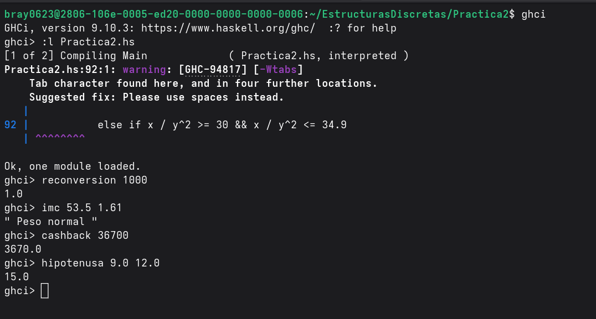

# README perteneciente a la práctica 2 de Estructuras Discretas
***
1. Actividad 1: 

***

2. Objetivo de practica
Comenzar a utilizar el lenguaje de programacion Haskell, un primer acercamiento al lenguaje para conocer sus expresiones mas simples, como se comportan, que pueden hacer por si solas y de que son capaces al implementarlas en una funcion.
Comanzar a programar en Haskell haciendo uso de las buenas practicas de programacion, con el fin de que nuestro codigo sea mas sencillo de entender para colaboradores externos o incluso para nosotros mismos en el futuro.
Comenzar a implementar los llamados "Commits atomicos" en busca de volver mas organizada y limpia la interfaz de commit's de nuestro repositorio personal.

***

3. Tiempo requerido para realizar la practica
Alrededor de 10 horas de trabajo repartidas en 2 dias, dichas 10 horas no fueron continuas para ninguno de los 2 dias, se trato de una dinamica de trabajo intermitente.
 

