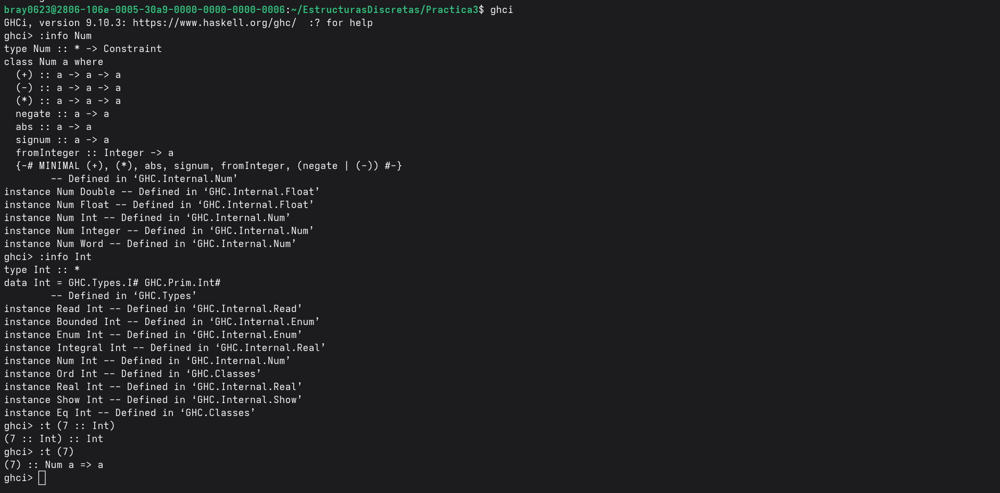

# README perteneciente a la practica 3 de Estructuras Discretas
***
1. Objetivo de la practica: comenzar a aplicar funciones mas complejas, tomando como base la creacion de nuevos tipos de datos, el uso de las listas por comprension y, la creacion e importacion de modulos para tener un codigo mas compacto y limpio.

***
2. Tiempo requerido para la practica: aproximandamente 13 horas de trabajo, divididas en 2 dias de trabajo intermitente.

***
3. Ejercicio favorito: mi ejercicio favorito fue el 5, donde se implemento la funcion soloPares, usando la funcion esParBit como base para el correcto funcionamiento de la funcion principal al importarla a traves de un modulo. Fue mi ejercicio favorito porque durante la clase presencial no me termino de quedar claro
cual era la manera correcta de crear un modulo y como podia importar dicho modulo a un nuevo proyecto .hs, este ejercicio me ayudo a reafirmar y reforzar esos conocimientos y poder sentirme mas seguro al momento de trabajar con modulos, por eso fue mi ejercicio favorito.

***
4. Como comentario adicional, debo decir que no implemente la creacion de nuevos tipos de datos durante esta practica, fue un tema que tampoco me quedo muy claro durante la clase del viernes y preferi implementar todas las funciones solicitadas a traves de metodos que ya conozco mejor.
 
***
5. Actividad 1: 

¿Cual es la diferencia entre Num e Int?
La difrerencia entre Num e Int es que Num es una clase de tipo, mientras que Int es un tipo de dato concreto. En palabras mas claras y sencillas, Num especifica una serie de operaciones metematicas/funciones que ciertos tipos de datos pueden realizar, pero al estos tipos de datos ser capaces de cumplir con los criterios que establece la clase de tipo Num, estos pasan a ser instancias de dicha clase de tipo. 
Por otra parte, Int es un tipo de dato que es capaz de representar numeros enteros sin decimales, con precision fija hasta 64 bits. Como tal, Int no tiene instancias como Num, por el contrario, Int puede ser una instancia de distintas clases de tipo, como: Enum, Num, Ord, Show, Eq, etc.
Toda esta informacion es claramente visible en la captura de pantalla adjunta. Si ejecutamos el comando ":info Num", podremos ver un listado de todas las intancias/tipos de datos que cumplen con las funciones que establece Num, una de ellas es justamante Int. Asimismo, al ejecutar el comando ":info Int", notaremos que se despliega un listado en el que se detalla que el tipo de dato Int es una instancia de distintas clases de tipo, entre ellas, la clase de tipo Num. 
Despues, al usar el comando ":t (7 :: Int)", el cual pregunta el tipo de la expresion siguiente a ':t', a la cual le asignamos el tipo Int, Haskell nos respondera 'Int', lo que quiere decir que un numero puede ser un tipo de dato Int si asi de lo asginamos, pero segun sea el caso, tambien puede ser un dato de tipo Float, Double. etc.
Finalmente, con el comando "t: (7)", que pregunta el tipo de dato de la expresion siguiente a 't:', Haskell nos responde que (7) puede ser cualquier tipo de dato siempre y cuando este sea una instancia de la clase de tipo Num, es decir, que (7) puede ser de tipo: Double, Float, Int, Integer, Word.

***
6. Actividad cancion Sal de Ahi Chivita Chivita
La recursion ocurre cuando una funcion o un proceso se "llama" a si mismo o se aplica sobre si mismo hasta un limite determinado por nuestro caso base. El caso base es la expresion minima del problema que buscamos resolver al aplicar dicha funcion/proceso y que lleguemos a el es nuestra señal para saber que hemos reducido el problema a su expresion minima y por lo tanto, esta resuelto.
En la cancion Sal de Ahi Chivita Chivita considero que podemos observar 2 casos donde se aplica la recursion, primeramente el proceso donde los animales se fueron subiendo 1 a 1 al la pila de objetos, el caso base seria cuando no hay ningun animal encima de los objetos y el caso recursivo haria que los animales vayan subiendo uno a uno para acumularlos sobre los objetos.
El segundo caso donde veo recursion seria cuando se fue bajando a los animales 1 a 1 hasta que no quedo ninguno sobre la pila de objetos. El caso base seria que ningun animal este parado sobre los objetos y el caso recursivo haria bajar a los animales 1 a 1 hasta que no quede ninguno parado sobre la pila de objetos.
